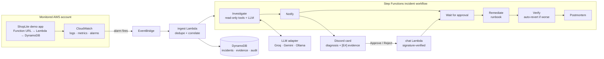

# NightWatch

**An open-source AI on-call agent for AWS.** When something breaks, NightWatch investigates logs,
metrics, recent changes and past incidents. It then posts an evidence-backed diagnosis to Discord,
where every claim links to the log line or metric it came from. Fixes run only after a human
approves them. NightWatch then verifies each fix and writes the incident up in an automatic
postmortem.

NightWatch is self-hosted and bring-your-own-LLM. It is designed to run at **$0 a month** on AWS
always-free services and free LLM tiers.

[](https://github.com/RaagulGananathan13/nightwatch/actions/workflows/ci.yml)
[](LICENSE)

> **Status: Phase 7 of 9 done.** NightWatch groups alarms into one incident per service, then an
> AI agent gathers evidence and posts a diagnosis that cites it. When the evidence matches a
> reviewed runbook, it proposes the fix, and the fix runs only after a human clicks **Approve** in
> Discord. Then it is verified. In an evaluation on 7 real injected faults, NightWatch named the
> root cause of **all 7**. Its diagnosis reached Discord a mean **46 seconds** after the alarm,
> every cited fact checked out against the evidence, and it proposed the right fix every time,
> all at $0 ([results](eval/results.md)). It also remembers past incidents, so a repeat
> failure is labelled with the earlier one. Every resolved incident gets a postmortem, and
> Discord's `/nw` commands can ask it questions. A web dashboard behind a login shows every
> incident with the evidence behind its diagnosis. Next are the differentiators (Phase 8). See the
> [roadmap](#roadmap) and the [infrastructure guide](infra/README.md).

## How it works



1. **Ingest.** A CloudWatch alarm fires, and EventBridge passes it to the ingest Lambda, which
   groups related alerts into one incident.
2. **Investigate.** The agent gathers evidence with read-only tools first. The LLM then writes a
   diagnosis that has to cite that evidence.
3. **Guard.** A deterministic validator checks every citation and number. Claims it can't support
   are labelled *unverified*.
4. **Approve.** Discord shows the diagnosis with **Approve / Reject** buttons, and the workflow
   waits, for free, until a human decides.
5. **Fix.** Approved fixes run from version-controlled runbooks. NightWatch verifies each fix and
   rolls it back automatically if things get worse.

## Roadmap

Each phase ends with something demo-able and a git tag. Phase *N* is tagged `v0.(N+1)`, and
Phase 9 is tagged `v1.0`.

| Phase | What ships | Status |
|---|---|---|
| 0 | Repository, tooling, CI | Done |
| 1 | Terraform base, $1 budget alert, GitHub OIDC, ShopLite demo app and its alarms | Done |
| 2 | Alert ingest, incident dedupe, Discord notifications, first chaos script | Done |
| 3 | Investigation agent, evidence ledger, hallucination guard | Done |
| 4 | Runbooks, approval buttons, remediation, audit log, kill switch | Done |
| 5 | Chaos lab and evaluation harness (accuracy, time to diagnosis) | Done |
| 6 | Incident memory, auto-revert, postmortems, ChatOps commands | Done |
| 7 | Web dashboard (React and Cognito) | Done |
| 8 | Fix-as-PR, alert-noise coach, predictions, status page, MCP server, cost guardian | In progress: fix-as-PR, alert coach, forecasts, status updates and MCP server done |
| 9 | Multi-account connect, docs, security review, launch | Planned |

## Cost

NightWatch only uses services that have an always-free allowance, and it is built to stay
inside those allowances.

| Service | How NightWatch stays free |
|---|---|
| Lambda | Function URLs instead of API Gateway ([ADR 0001](docs/decisions/0001-function-urls-instead-of-api-gateway.md)) |
| DynamoDB | Provisioned capacity, 25 RCU / 25 WCU or less across all tables ([ADR 0002](docs/decisions/0002-dynamodb-provisioned-capacity.md)) |
| Step Functions (Standard) | A few dozen state transitions per incident, out of 4,000 free each month |
| CloudWatch | 10 alarms or fewer, `GetMetricStatistics` only, short log retention ([ADR 0007](docs/decisions/0007-free-aws-api-calls-only.md)) |
| EventBridge | AWS service events on the default bus are free |
| SSM Parameter Store | Standard SecureString parameters with the AWS-managed key |
| S3 | A few MB of state, postmortems and static site; well under one cent a month once the 12-month free tier ends |
| LLM | Groq or Gemini free tiers, or Ollama locally ([ADR 0003](docs/decisions/0003-llm-strategy-and-call-budget.md)) |
| GitHub Actions | Free for public repositories |

Phase 1 adds an AWS Budget that emails an alert at $1.

## Develop locally

You need Python 3.13, Git, GNU make and Terraform 1.11 or later. On Windows, install the last
two with `winget install ezwinports.make Hashicorp.Terraform`, and run `make` from Git Bash.

```bash
make install     # create .venv, install the dev tools, enable the pre-commit hooks
make check       # lint, type-check and unit tests (the same as CI)
make help        # list every task
```

To deploy to your own AWS account, follow the step-by-step [infrastructure guide](infra/README.md).

## See it work

With the stack deployed and a Discord webhook stored (see the infrastructure guide), run:

```bash
make chaos-bad-deploy
```

A real commit with a bug is deployed to ShopLite as a new Lambda version. The alarms fire, and
NightWatch groups them into **one** incident with **one** Discord message that it keeps editing.
About a minute later the message gains a **diagnosis** that names the commit, with numbered
evidence references (`[E4]`), confidence, and anything it couldn't verify. The script rolls the
deploy back afterwards and reports PASS or FAIL. The [chaos lab](chaos/README.md) has the
details.

To let NightWatch fix it instead (Phase 4):

```bash
make chaos-fix
```

The bad version stays live. Under the incident's message, NightWatch posts a **proposed fix**:
roll the `live` alias back to the version that was live before the deploy. The card shows the
exact change, why (the evidence), the blast radius, how it will be verified, and how it can be
undone. It pings the approvers listed in `services.yaml`, and the fix runs only when one of
them clicks **Approve**. NightWatch then checks the error metric for 2 minutes and undoes its
own fix if things got worse. **Reject** changes nothing. Setting `/nightwatch/kill_switch` to
`true` stops every fix ([ADR 0012](docs/decisions/0012-approval-gated-remediation.md),
[runbooks](runbooks/README.md)).

NightWatch remembers every incident and writes its postmortem (Phase 6):
- When an incident resolves, a blameless postmortem lands in S3, and the Discord card links to
  it.
- The incident is added to NightWatch's memory. A repeat of the same failure shows "Looks like
  INC-015 ..." on its card.
- In Discord, `/nw status` lists open incidents and `/nw ack INC-12` takes one.
- `/nw ask why is checkout slow?` runs a read-only investigation and posts the answer with its
  evidence ([ADR 0014](docs/decisions/0014-memory-postmortems-chatops.md)).

The [web dashboard](dashboard/README.md) (Phase 7) shows the same incidents in a browser. Each
diagnosis links every `[E#]` to the evidence viewer: the exact query, its raw result, and
whether the guard verified it. Each incident also shows its timeline, fixes, approvals and
postmortem, and the evaluation results are charted. It is served by CloudFront from a private
bucket, behind a Cognito sign-in with no self sign-up. Its API is read-only and only CloudFront
can call it ([ADR 0015](docs/decisions/0015-dashboard.md)).

### Measured so far

**Evaluation, Phase 5 (2026-10-29, `make eval`).** Seven real faults were injected into ShopLite,
one after another. Each was scored against its written ground truth
([full results](eval/results.md), [method](docs/decisions/0013-evaluating-nightwatch.md)):

| Metric | Result |
|---|---|
| Top-1 root-cause accuracy | **7/7** |
| Mean time to diagnosis (alarm → diagnosis in Discord) | **46 s** |
| Mean time from fault to diagnosis | 2 min 01 s |
| Evidence validity (hypotheses whose cited facts the guard verified) | **11/11** |
| Right fix proposed | 7/7 |
| Alerts grouped into incidents | 17 → 7 |
| LLM use per incident | 1 call, about 3,500 tokens |

The faults were:
- an error flag;
- a buggy commit;
- a slow dependency;
- a Lambda timeout;
- memory exhaustion;
- DynamoDB throttling after a capacity cut;
- a broken environment variable.

Each ran once, so treat these as a first measurement, not a benchmark. A first attempt, stopped
after 2 scenarios, misdiagnosed the buggy commit. A 30-minute log window still held the previous
scenario's errors, so the model blamed that scenario's flag instead. That was fixed and the whole
evaluation was run again. Every top hypothesis is quoted word for word in the results.

**Phase 6, memory (2026-10-30, `make memory-check`).** The same buggy deploy ran twice:
1. INC-015 opened. Its diagnosis reached Discord 46 s after the alarm and named the commit.
   When it resolved, its postmortem (3,354 characters) was written to S3.
2. Ten minutes later the bug was deployed again as INC-016. Its card said **"Looks like INC-015"**
   and gave INC-015's cause and fix.

That link comes from NightWatch's incident memory, not from the model: the model's own text
didn't name INC-015. Postmortems for the 14 earlier incidents were then backfilled into S3 and
memory.

**Phase 8, fix-as-pull-request (2026-10-30, `make chaos NAME=traffic-surge`).** Nothing was
changed. Three canaries simply read more than the 5 units Terraform provisions for ShopLite's
table:
1. INC-017 opened. The diagnosis said the 5 provisioned read units are "insufficient for the
   traffic" (verified, 95%).
2. No runbook applied, because there was no change to undo.
3. NightWatch opened a pull request with a one-line change: `read_capacity` 5 → 10 in
   `infra/modules/shoplite/variables.tf`. The description has the diagnosis, the evidence it
   cites and a link to the incident in the dashboard.
4. CI ran the Terraform plan on the pull request: `read_capacity = 5 -> 10`, with the
   free-tier guard showing "15 of 25" → "20 of 25" read units.

A person reviews, merges and runs `make apply`
([ADR 0016](docs/decisions/0016-fix-as-pull-request.md)).

**Phase 8, alert-quality coach (2026-10-30, `make coach`).** The coach scored 4 alarms over
17 incidents (38 firings). It flagged `shoplite-lambda-errors` and `shoplite-5xx-rate` (noise
81 and 80): they page on a single bad minute, and most of their pages cleared by themselves.
It suggested requiring 2 bad minutes out of 3, and said to keep `shoplite-dynamodb-throttles`.
Those pages were the chaos lab's own experiments, which the lab undid, so "cleared by itself"
is literally true here. The report is on the dashboard's Alarms page and is posted to Discord
every Monday ([ADR 0017](docs/decisions/0017-alert-quality-coach.md)).

**Phase 8, predictive warnings (2026-10-30, `make forecast`).** The first run made 6
forecasts. The free tiers are far off:
- 32,566 Lambda requests so far this month, heading for 4% of the free million;
- Lambda compute and log ingestion both under 1% of theirs;
- at most 17 functions running at once, of the account's limit of 400.

Two warnings went to Discord. ShopLite's error budget is spent 20 times over: 2,926 failed
requests where a 99.5% target allows 146. Its table's busiest hour of reads is also climbing
toward the 5 provisioned units, and the trend reaches them around 3 November. The chaos lab's
experiments caused both. Forecasts run every morning and appear on the dashboard's Forecasts
page. Discord hears only when one gets worse
([ADR 0018](docs/decisions/0018-predictive-warnings.md)).

**Phase 8, stakeholder updates (2026-10-30, `/nw update incident:INC-017`).** One call to
gpt-oss-120b drafted both updates for the resolved read-capacity incident. The customer update
was plain and named nothing internal: "We experienced a brief outage where all ShopLite API
requests were returning errors. The issue was identified and resolved, and the service is now
operating normally." The leadership summary kept the internal detail: DynamoDB, the Lambda
version, and the configuration change waiting for review. It also repeated one inaccuracy
from the diagnosis itself, which called version 12 "newly deployed" when the cause was a
traffic surge. The guard checks numbers and versions against the evidence, not that kind of
claim, which is one reason the summary is never published. One click on **Publish to status page** put the customer
update on the public page (`/status/index.html` on the dashboard's address), under "All
systems operational". The first try showed no buttons, because the code that edits a slash
command's reply dropped them; that was fixed the same evening
([ADR 0019](docs/decisions/0019-stakeholder-updates.md)).

**Phase 8, MCP server (2026-10-30, `make mcp-check`).** `python -m nightwatch.mcp_server`
gives your own AI assistant (Claude Code, Claude Desktop) 11 read-only tools: four for
incidents and evidence, plus the investigator's seven. Run against the deployed stack, it
switched to the `nightwatch-mcp` role and answered `whats_going_on` ("No open incidents", plus
the two forecast warnings). Over stdio it then returned INC-017's diagnosis with its verified
hypothesis and evidence list, and `recent_changes` read CloudTrail under the role. Every call
is redacted like evidence bound for an LLM and written to the audit log under `mcp:<caller>`
([ADR 0020](docs/decisions/0020-mcp-server.md)). To add it to Claude Code (on macOS or Linux
the Python is `.venv/bin/python`):

```bash
claude mcp add nightwatch -- /path/to/nightwatch/.venv/Scripts/python.exe -m nightwatch.mcp_server
```

Earlier runs against the deployed stack, from 2026-10-28:

| Run | Fault start → incident + Discord message | Alarms grouped | Messages posted |
|---|---|---|---|
| 1 | 49 s | 1 (`shoplite-lambda-errors`) | 1 |
| 2 | 66 s | 2 (`shoplite-lambda-errors`, `shoplite-5xx-rate`), fired 23 s apart | 1 |

Run 1 exposed that function URLs don't count crashed invocations in `Url5xxCount`. The 5xx alarm
now uses Lambda's `Errors` metric ([ADR 0001](docs/decisions/0001-function-urls-instead-of-api-gateway.md)).

**Phase 3, bad deploy (2026-10-29).** A real buggy commit was deployed as ShopLite version 7:

| Step | Time after the alarm |
|---|---|
| Discord message posted | 0.8 s |
| Second alarm grouped into it | 21 s |
| Investigation started (after a deliberate 30 s wait for related alarms) | 32 s |
| **Diagnosis posted** | **41 s** |

The diagnosis named version 7, commit `f4584c11d9b5` and the `KeyError` on `price`. Its top
hypothesis was verified at 94% against 6 cited evidence items. It took one `gpt-oss-120b` call
(3,182 tokens, 1.0 s) on Groq's free tier, and the investigation took 6.1 s in total.

The run before it diagnosed the cause just as correctly, but the guard marked it unverified: the
model quoted the alarm's 92% error rate while citing other evidence. The guard now repairs
mis-cited facts that exist in the ledger, and still rejects facts found nowhere
([ADR 0011](docs/decisions/0011-evidence-ledger-guard-and-workflow.md)).

**Phase 4, approved fix (2026-10-29, `make chaos-fix`).** Commit `79085874d59d` went live as
ShopLite version 10, replacing version 9. Times are from INC-005's audit log:

| Step | Time after the alarm |
|---|---|
| Diagnosis posted, naming version 10 and its commit (verified, 94%) | 44 s |
| Fix proposed and approval card posted: roll `live` back from 10 to 9 | 46 s |
| Approve clicked (a human took about 5 minutes) | 5 min 44 s |
| **Rollback done** | **2.5 s after the click** |
| Both alarms recovered and the incident resolved | 97 s after the fix |
| **Verified**: `Errors` were 0, 0, 0 in the 3 full minutes after the fix, down from 15 a minute | 3 min 8 s after the fix |

The rollback target came from the evidence, not the model: the deploy had recorded `prev=9`.
The version numbered just before it isn't always a good build. The audit log shows the whole chain:
`remediation_proposed`, `approval_requested`, `approval_decided` (who and when),
`remediation_executed` (state before and after), `remediation_verified`. Rejecting, double clicks,
clicks from non-approvers, forged or replayed requests, the kill switch and auto-undo are covered by
unit tests ([ADR 0012](docs/decisions/0012-approval-gated-remediation.md)).

## Repository layout

```text
├── nightwatch/          # Python package: ingest, agent, remediation, chat, memory, ...
├── shoplite/            # demo app NightWatch watches (Phase 1)
├── infra/               # Terraform: bootstrap, modules, envs/dev
├── runbooks/            # approved fixes as YAML (Phase 4)
├── stepfunctions/       # incident workflow: investigate, approve, fix, verify
├── chaos/               # failure-injection scenarios with ground truth
├── eval/                # evaluation harness and results
├── dashboard/           # React web dashboard (Phase 7)
├── docs/decisions/      # architecture decision records
└── tests/               # unit tests (no real AWS) and opt-in integration tests
```

## Design decisions

[docs/decisions](docs/decisions/README.md) records where NightWatch departs from the original
spec and why. The full build spec is [NightWatch-SPEC.md](NightWatch-SPEC.md).

## License

Apache-2.0. See [LICENSE](LICENSE).
