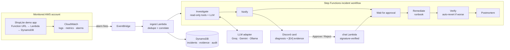

# NightWatch

**An open-source AI on-call agent for AWS.** When something breaks, NightWatch investigates logs,
metrics, recent changes and past incidents. It then posts an evidence-backed diagnosis to Discord,
where every claim links to the log line or metric it came from. Fixes run only after a human
approves them. NightWatch then verifies each fix and writes the incident up in an automatic
postmortem.

NightWatch is self-hosted and bring-your-own-LLM. It is designed to run at **$0 a month** on AWS
always-free services and free LLM tiers.

[](https://github.com/RaagulGananathan13/nightwatch/actions/workflows/ci.yml)
[](LICENSE)

> **Status: Phase 3 of 9 done.** NightWatch groups alarms into one incident per service, then an
> AI agent gathers evidence and posts a diagnosis that cites it. In live tests the diagnosis arrived
> 41 seconds after the alarm and named the exact bad commit, all at $0. Next is approval-gated
> remediation (Phase 4). See the [roadmap](#roadmap) and the [infrastructure guide](infra/README.md).

## How it works



1. **Ingest.** A CloudWatch alarm fires, and EventBridge passes it to the ingest Lambda, which
   groups related alerts into one incident.
2. **Investigate.** The agent gathers evidence with read-only tools first. The LLM then writes a
   diagnosis that has to cite that evidence.
3. **Guard.** A deterministic validator checks every citation and number. Claims it can't support
   are labelled *unverified*.
4. **Approve.** Discord shows the diagnosis with **Approve / Reject** buttons, and the workflow
   waits, for free, until a human decides.
5. **Fix.** Approved fixes run from version-controlled runbooks. NightWatch verifies each fix and
   rolls it back automatically if things get worse.

## Roadmap

Each phase ends with something demo-able and a git tag. Phase *N* is tagged `v0.(N+1)`, and
Phase 9 is tagged `v1.0`.

| Phase | What ships | Status |
|---|---|---|
| 0 | Repository, tooling, CI | Done |
| 1 | Terraform base, $1 budget alert, GitHub OIDC, ShopLite demo app and its alarms | Done |
| 2 | Alert ingest, incident dedupe, Discord notifications, first chaos script | Done |
| 3 | Investigation agent, evidence ledger, hallucination guard | Done |
| 4 | Runbooks, approval buttons, remediation, audit log, kill switch | Planned |
| 5 | Chaos lab and evaluation harness (accuracy, time to diagnosis) | Planned |
| 6 | Incident memory, auto-revert, postmortems, ChatOps commands | Planned |
| 7 | Web dashboard (React and Cognito) | Planned |
| 8 | Fix-as-PR, alert-noise coach, predictions, status page, MCP server, cost guardian | Planned |
| 9 | Multi-account connect, docs, security review, launch | Planned |

## Cost

NightWatch only uses services that have an always-free allowance, and it is built to stay
inside those allowances.

| Service | How NightWatch stays free |
|---|---|
| Lambda | Function URLs instead of API Gateway ([ADR 0001](docs/decisions/0001-function-urls-instead-of-api-gateway.md)) |
| DynamoDB | Provisioned capacity, 25 RCU / 25 WCU or less across all tables ([ADR 0002](docs/decisions/0002-dynamodb-provisioned-capacity.md)) |
| Step Functions (Standard) | A few dozen state transitions per incident, out of 4,000 free each month |
| CloudWatch | 10 alarms or fewer, `GetMetricStatistics` only, short log retention ([ADR 0007](docs/decisions/0007-free-aws-api-calls-only.md)) |
| EventBridge | AWS service events on the default bus are free |
| SSM Parameter Store | Standard SecureString parameters with the AWS-managed key |
| S3 | A few MB of state, postmortems and static site; well under one cent a month once the 12-month free tier ends |
| LLM | Groq or Gemini free tiers, or Ollama locally ([ADR 0003](docs/decisions/0003-llm-strategy-and-call-budget.md)) |
| GitHub Actions | Free for public repositories |

Phase 1 adds an AWS Budget that emails an alert at $1.

## Develop locally

You need Python 3.13, Git, GNU make and Terraform 1.11 or later. On Windows, install the last
two with `winget install ezwinports.make Hashicorp.Terraform`, and run `make` from Git Bash.

```bash
make install     # create .venv, install the dev tools, enable the pre-commit hooks
make check       # lint, type-check and unit tests (the same as CI)
make help        # list every task
```

To deploy to your own AWS account, follow the step-by-step [infrastructure guide](infra/README.md).

## See it work

With the stack deployed and a Discord webhook stored (see the infrastructure guide), run:

```bash
make chaos-bad-deploy
```

A real commit with a bug is deployed to ShopLite as a new Lambda version. The alarms fire, and
NightWatch groups them into **one** incident with **one** Discord message that it keeps editing.
About a minute later the message gains a **diagnosis** that names the commit, with numbered
evidence references (`[E4]`), confidence, and anything it couldn't verify. The script rolls the
deploy back afterwards and reports PASS or FAIL. The [chaos lab](chaos/README.md) has the
details.

### Measured so far

Real runs against the deployed stack on 2026-10-28. Full evaluation numbers arrive with the
Phase 5 harness.

| Run | Fault start → incident + Discord message | Alarms grouped | Messages posted |
|---|---|---|---|
| 1 | 49 s | 1 (`shoplite-lambda-errors`) | 1 |
| 2 | 66 s | 2 (`shoplite-lambda-errors`, `shoplite-5xx-rate`), fired 23 s apart | 1 |

Run 1 exposed that function URLs don't count crashed invocations in `Url5xxCount`. The 5xx alarm
now uses Lambda's `Errors` metric ([ADR 0001](docs/decisions/0001-function-urls-instead-of-api-gateway.md)).

**Phase 3, bad deploy (2026-10-29).** A real buggy commit was deployed as ShopLite version 7:

| Step | Time after the alarm |
|---|---|
| Discord message posted | 0.8 s |
| Second alarm grouped into it | 21 s |
| Investigation started (after a deliberate 30 s wait for related alarms) | 32 s |
| **Diagnosis posted** | **41 s** |

The diagnosis named version 7, commit `f4584c11d9b5` and the `KeyError` on `price`. Its top
hypothesis was verified at 94% against 6 cited evidence items. It took one `gpt-oss-120b` call
(3,182 tokens, 1.0 s) on Groq's free tier, and the investigation took 6.1 s in total.

The run before it diagnosed the cause just as correctly, but the guard marked it unverified: the
model quoted the alarm's 92% error rate while citing other evidence. The guard now repairs
mis-cited facts that exist in the ledger, and still rejects facts found nowhere
([ADR 0011](docs/decisions/0011-evidence-ledger-guard-and-workflow.md)).

## Repository layout

```text
├── nightwatch/          # Python package: ingest, agent, remediation, chat, memory, ...
├── shoplite/            # demo app NightWatch watches (Phase 1)
├── infra/               # Terraform: bootstrap, modules, envs/dev
├── runbooks/            # approved fixes as YAML (Phase 4)
├── stepfunctions/       # incident workflow definition (Phase 3)
├── chaos/               # failure-injection scenarios with ground truth
├── eval/                # evaluation harness and results
├── dashboard/           # React web dashboard (Phase 7)
├── docs/decisions/      # architecture decision records
└── tests/               # unit tests (no real AWS) and opt-in integration tests
```

## Design decisions

[docs/decisions](docs/decisions/README.md) records where NightWatch departs from the original
spec and why. The full build spec is [NightWatch-SPEC.md](NightWatch-SPEC.md).

## License

Apache-2.0. See [LICENSE](LICENSE).
