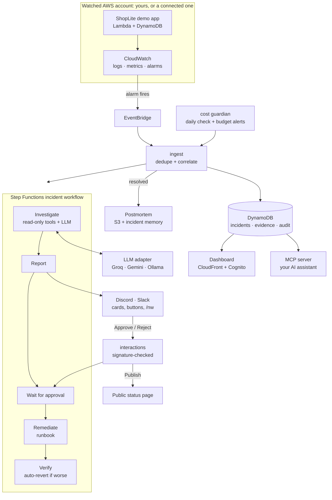

# Architecture

Everything is serverless and event-driven, so nothing runs, or costs anything, between
incidents.

| Part | What it does | Decision |
|---|---|---|
| Ingest | Turns an alarm (or a cost signal) into an incident: one per service, deduplicated, flap-proof | [ADR 0010](decisions/0010-one-active-incident-per-service.md) |
| Investigator | Gathers evidence with read-only tools, then asks the LLM; a guard checks every claim | [ADR 0011](decisions/0011-evidence-ledger-guard-and-workflow.md) |
| Remediation | Runbooks as code, a human approval, verification and automatic undo | [ADR 0012](decisions/0012-approval-gated-remediation.md) |
| Memory and postmortems | Similar past incidents; a blameless postmortem per incident | [ADR 0014](decisions/0014-memory-postmortems-chatops.md) |
| Dashboard | A read-only web view behind a Cognito login | [ADR 0015](decisions/0015-dashboard.md) |
| Beyond the incident | Fix pull requests, alert coach, forecasts, status page, MCP server, cost guardian, Slack | ADRs 0016 to 0022 |
| Connected accounts | A read-only role in another account, assumed with an ExternalId | [ADR 0023](decisions/0023-connected-accounts.md) |

## Trust boundaries

- **The investigator only reads.** It has no write tool. Log text reaches the model only as
  data, and it can't name a resource outside the service's catalogue.
- **Fixes need a person.** Each fix is a reviewed runbook with validated parameters. It runs
  after a signed click from an approver, under a kill switch that stops every fix.
- **Each role is fenced to its tenant's keys** in DynamoDB, and to the NightWatch permissions
  boundary.

The [security review](security-review.md) maps every rule to where it is enforced.
